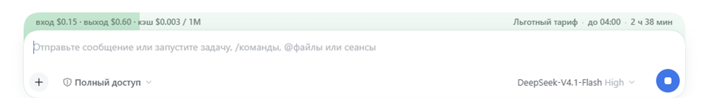

# dsh-peak-opencode · OpenCode Go cost/peak

[English](https://github.com/lavandiI/dsh-peak-opencode/blob/main/README.md) · **Русский**



Полоса над полем ввода в DeepSeek Harness показывает тариф текущей модели и её цену:

- **Пиковый** — светло-розовый, с обратным отсчётом до конца периода.
- **Льготный** — светло-зелёный, тоже с отсчётом.
- **Единый** — мягкий синий, без отсчёта: у модели нет пиковых и льготных часов.
- **Бесплатный** — зелёный, без отсчёта: цена нулевая, периодов и таймера нет.

Слева в полосе — цена текущего тарифа за 1M токенов (`вход · выход · кэш`, а если модель тарифицирует запись в кэш — ещё и `зап.`), справа — фаза, конец периода по вашему времени и остаток. Заливка полосы показывает, сколько периода ещё осталось; у единого и бесплатного тарифа заливка сплошная.

Работает для **всех моделей OpenCode Go**. Каталог моделей, цены и правила множителей подтягиваются с `opencode.ai` при запуске DSH и кэшируются; модели с пиковыми часами (DeepSeek V4.1 Flash и V4 Pro) считаются по окнам из каталога, модели с множителем по дате (Gemini 4 Argon) — по дате, бесплатные — зелёной полосой «Бесплатный тариф», остальные — синей «Единый тариф».

Для DeepSeek-аккаунта (`deepseek-account/deepseek-flash` — это V4.1 Flash 1017, а также `deepseek-v4-pro`) цены и пиковые окна тоже работают: они совпадают с официальным прайсом DeepSeek и не зависят от каталога Go.

## Каталог и правила

Источник — публичный `https://opencode.ai/inference/go/v1/models` (API-ключ не нужен).

- Хостовая половина плагина при старте DSH забирает каталог, кэширует его на 6 часов и отдаёт браузеру по `/dsh-peak-opencode/models`. Ответ помечен версией формата; если запущен старый хост (после обновления плагина без перезапуска DSH), клиент не принимает его ответ и берёт публичный каталог напрямую.
- Если хостовый маршрут ещё не загружен (старая версия хоста до перезапуска DSH), браузер забирает тот же эндпоинт напрямую — CORS у него открыт.
- Снимок каталога лежит в `localStorage`, поэтому при обновлении страницы полоса рисуется сразу, не дожидаясь сети.
- В настройках видно, сколько моделей в каталоге, какие из них с пиковыми часами и у каких множитель привязан к дате, когда каталог обновлялся; есть кнопка «Обновить каталог».

Пиковые часы DeepSeek по каталогу: **пн–пт `01:00–04:00` и `06:00–10:00` UTC** (это `09:00–12:00` и `14:00–18:00` по Пекину, `04:00–07:00` и `09:00–13:00` по Минску), множитель **×2**. Всё остальное — льготный тариф. Праздники Китая на 2026 год внутри; перенесённые рабочие субботы и воскресенья не учитываются — DeepSeek смотрит только на будни, выходные и праздники.

Модели без множителей (GLM, Kimi, Qwen, MiniMax, GPT, Claude, Grok и остальные из Go) показываются синей полосой «Единый тариф»: цена у них постоянная. **Бесплатные** модели (`beam-free`, `iceman-contributor-free`, `longcat-2.5-free` и переименованные вроде `longcat-2.5-preview-free`) — зелёной полосой «Бесплатный тариф»: цена нулевая, пиковых и льготных периодов нет. Модели **с множителем ×2** считаются льготными, пока множитель не действует: у DeepSeek он включается по часам (окна выше), у Gemini 4 Argon — по дате `01.12.2026`; до неё полоса зелёная, после — розовая с ценой ×2.

## Внешний вид

- Полоса той же ширины, что карточка ввода, с теми же верхними углами. Нижний край уходит под карточку, и в её вырезах видно цвет полосы.
- **Слева — цена текущего тарифа** за 1M токенов в порядке «вход · выход · кэш»: `вход $0.30 · выход $1.20 · кэш $0.006 / 1M` в пик, `вход $0.15 · выход $0.60 · кэш $0.003 / 1M` в льготный, базовая цена — у единого тарифа. Запись в кэш, если модель её тарифицирует, показывается как `зап. $…` после кэша. У бесплатных моделей — зелёная полоса с надписью `бесплатно`: она не зависит от того, под каким id модель лежит в каталоге Go. Когда провайдер переименовывает бесплатную модель (`longcat-2.5-preview-free` в DSH против `longcat-2.5-free` в каталоге), цена всё равно известна из суффикса `-free`; а платную запись каталога бесплатная модель не получает, даже если после срезания суффикса id совпал (`step-5-preview-free` и `step-5-preview`).
- У пиковых моделей граница заливки — процент **оставшегося** периода; справа фаза, конец периода в вашем поясе и остаток: `Льготный тариф · до 13:00 · 3 ч 49 мин`.
- У модели с единым тарифом заливка сплошная синяя, справа — `Единый тариф · без пиковых часов`. Прогресса и таймера нет, потому что нет периода.
- У бесплатной модели заливка сплошная зелёная, справа — `Бесплатный тариф · без пиковых часов`, слева — `бесплатно`. Таймера тоже нет: цена не зависит от времени.
- У модели с множителем по дате заливка тоже сплошная, но цвет по фазе: до даты — `Льготный тариф · до 1 дек. · 21 день`, после — `Пиковый тариф · с 1 дек.` и цена уже с множителем.
- На первом экране цена переезжает во вторую строку полосы — под чипы «проект / режим», над карточкой ввода: в одну строку с чипами она не помещается. Полоса становится выше на строку цены, карточка сдвигается вниз, поэтому цена остаётся внутри цветного поля.
- На первом экране строка «проект / режим» ложится на полосу; высота строки, отступы и линия цены измеряются только при реальном изменении раскладки, поэтому набор текста полосу не дёргает.
- На узких окнах (уже 640px) цена скрыта, чтобы не перекрывать подписи; на первом экране в этом случае полоса остаётся одной строкой.
- Обводка карточки ввода повторяет цвет полосы: зелёная (льготный или бесплатный тариф), розовая или синяя.
- В подсказке при наведении — название модели, цены за 1M токенов и множитель пика (для DeepSeek).

## Настройки

**Плагины → OpenCode Go cost/peak** (открой карточку плагина — настройки показываются прямо на его странице, слот `plugins.bundle.config`):

- **Каталог моделей** — сколько моделей, какие с пиковыми часами, время обновления, кнопка «Обновить каталог» и предупреждение, если сеть недоступна.
- **Пиковые окна** — окна по Пекину с пересчётом в ваш пояс; используются для моделей с пиком. Кнопка «Вернуть официальные окна» подставляет окна из каталога.
- **Поведение** — «Показывать для моделей вне каталога Go»: все модели Go и так видны; галочка добавляет синюю полосу моделям других провайдеров.
- **Свой CSS** — добавляется после базовых стилей. «Применить» активна только при изменениях; после сохранения или очистки под кнопками появляется подтверждение. Поле пустое, пока свой CSS не сохранён, — пример показан в справке ниже.
- **Сброс** — отдельный блок: возвращает пиковые окна, поведение и CSS к значениям по умолчанию и сначала просит подтверждение.

Тем в плагине нет: цвета фиксированы (зелёный, розовый, синий; у бесплатных — тот же зелёный). Если нужны другие оттенки — переопределите переменные `--pc-c-valley`, `--pc-c-peak`, `--pc-c-flat`, `--pc-c-free` через «Свой CSS».

### Хуки для своего CSS

| Селектор / переменная | Что делает |
| --- | --- |
| `:root{--pc-c-valley / --pc-c-peak / --pc-c-flat / --pc-c-free}` | цвета льготного, пикового, единого и бесплатного тарифа; они же задают обводку карточки |
| `.pc-bar{--pc-band / --pc-tuck / --pc-lift}` | видимая высота, глубина под карточкой, подъём текста |
| `.pc-bar[data-hero]{--pc-hero-radius}` | верхние углы на первом экране |
| `.pc-bar[data-phase="peak"]`, `[data-phase="valley"]`, `[data-phase="flat"]`, `[data-phase="free"]` | стили отдельной фазы |
| `--pc-pct` | процент оставшегося периода (у единого и бесплатного тарифа — `100%`) |
| `.pc-bar[data-hero-price]` | вторая строка с ценой на первом экране: `--pc-hero-price-line` (её высота), `top` и отступ слева |
| `.pc-price` | левая цена тарифа; на первом экране — вторая строка полосы под чипами, на узких окнах скрыта |
| `.pc-phase`, `.pc-until`, `.pc-left` | подписи фазы, конца периода и остатка |

```css
:root{ --pc-c-valley:#c8ecd8; --pc-c-peak:#ffb3ab; --pc-c-flat:#c7dcf5; --pc-c-free:#c8ecd8 }
.pc-bar[data-hero]{ --pc-hero-radius:20px }
.pc-left{ font-weight:600 }
```

## Языки

Плагин переведён на все языки, которые официально поддерживает DSH: **английский, китайский, японский, испанский, французский, немецкий, русский и португальский**.

- Плагин **всегда следует языку DSH**: своего переключателя нет. Переключили язык в DSH — полоса, панель плагина и описание в «Плагинах» сразу переключились.
- Длинное описание на странице плагина тоже локализовано: в каждом `locale/<язык>.json` указан `meta.detail` на свой файл `detail/<язык>.md`. Без этого DSH показывал бы один и тот же `README.md` на всех языках.
- Даты, дни недели, длительности и числа форматируются через `Intl` под язык DSH (`5 ч 30 мин`, `5 hr 30 min`, `5時間30分`), а не пересобираются вручную.
- Если сервис `locale` недоступен, плагин берёт `<html lang>` или язык браузера; неизвестный язык откатывается на английский.
- Для менеджера плагинов в `locale/` лежат метаданные (`title`, `description`) на всех восьми языках.

## Установка

### Из npm (для всех)

Пакет опубликован: [`dsh-peak-opencode@0.4.4`](https://www.npmjs.com/package/dsh-peak-opencode) — актуальная версия в репозитории.

- GUI: **Настройки → Плагины → Установить** → `dsh-peak-opencode`
- CLI: `dsh plugin --profile desktop add dsh-peak-opencode`

DSH добавит пакет в профиль (`dsh.profile.bundles`), применит `cordis.patch.yml` и отдаст клиентскую половину по `/plugins/dsh-peak-opencode/client.js`. После установки перезапустите DSH (нужна хостовая половина) и обновите страницу Web GUI.

### Локально (разработка)

Плагин можно поставить как локальный bundle:

```text
plugin_manager action=install_bundle target=<path-to-plugin>
```

или из GUI: **Настройки → Плагины → Установить** и путь к папке плагина. После установки обновите страницу Web GUI (Ctrl+R / F5).

Клиентская половина подхватывается обновлением страницы. Хостовая половина (маршрут каталога) загружается при старте DSH: после её изменения нужен перезапуск приложения. До перезапуска плагин работает через прямой запрос к публичному каталогу, так что полоса не пропадает.

Как опубликовать пакет для всех — см. [PUBLISHING.md](https://github.com/lavandiI/dsh-peak-opencode/blob/main/PUBLISHING.md).

## Ограничения

- Праздники Китая есть только для 2026 года; в другие годы учитываются лишь выходные.
- Слева показывается **базовая** цена за 1M токенов. У моделей с порогом контекста (GPT Luna, Claude Haiku, Grok 4.7, MiniMax M3, Qwen3.7 Plus) цена выше порога не отображается — для точной стоимости смотрите каталог OpenCode Go.
- У **Gemini 4 Argon** множитель `×2` привязан к дате (`с 01.12.2026`), а не к часам: часовых окон у модели нет, поэтому до этой даты она считается льготной, а после — пиковой. Внутри периода прогресса нет, заливка сплошная.
- Слева видна только цена текущего тарифа; множитель ×2 (пик или дата) применён к ней автоматически, отдельной строки «дороже» в полосе нет — она есть в подсказке при наведении.
- У бесплатных моделей цена не зависит от каталога: она берётся из суффикса `-free` в id. Поэтому «бесплатно» видно и тогда, когда Go переименовал модель и каталог не нашёл точного совпадения.
- Каталог и множители пика — публичные данные OpenCode Go; если провайдер изменит формат, плагин откатится к встроенным правилам DeepSeek и покажет предупреждение в настройках.
- Для других провайдеров (не `opencode-go`) каталог Go не применяется: DeepSeek считается по встроенным правилам, остальные модели показываются синей полосой только с включённой галочкой «для моделей вне каталога Go».
- Позиционирование опирается на слот `conversation.input.dock` и атрибут `data-composer-card`; если хост поменяет контракт, полоса просто перестанет появляться. Настройки регистрируются в слоте `plugins.bundle.config` по имени пакета и видны на странице плагина в «Плагинах»; если слот переименуют, панель настроек пропадёт, а полоса продолжит работать.

## Устройство

- `lib/index.js` — хостовая половина: забирает каталог при старте DSH, кэширует и отдаёт `/dsh-peak-opencode/models`.
- `lib/client.js` — полоса, настройки, разбор каталога, словари восьми языков и прямой fallback-запрос, регистрируется через `window.__ModuleLoader__.load`.
- Настройки — в `localStorage` (`dsh-peak-opencode:settings`), снимок каталога — в `dsh-peak-opencode:catalog:v3`.
- `locale/<язык>.json` — название, краткое описание и `meta.detail`; `detail/<язык>.md` — длинное описание, которое DSH показывает на странице плагина.
- Слоты: `conversation.input.dock` (`order: 60`) для полосы и `plugins.bundle.config` (`key: dsh-peak-opencode`) для панели настроек на странице плагина.
- Сборки нет: чистый ESM/JS. `npm test` проверяет синтаксис, рендер полосы и настроек на заглушке React (синяя и зелёная полосы, все языки, режим «как в DSH») и хостовый маршрут каталога на реальном формате эндпоинта.

## Участие

Issues и pull requests приветствуются: [CONTRIBUTING.md](https://github.com/lavandiI/dsh-peak-opencode/blob/main/CONTRIBUTING.md), [CODE_OF_CONDUCT.md](https://github.com/lavandiI/dsh-peak-opencode/blob/main/CODE_OF_CONDUCT.md).

## Безопасность

Об уязвимостях — приватно через вкладку Security репозитория: [SECURITY.md](https://github.com/lavandiI/dsh-peak-opencode/blob/main/SECURITY.md).

## Лицензия

[MIT](https://github.com/lavandiI/dsh-peak-opencode/blob/main/LICENSE) © lavandil
