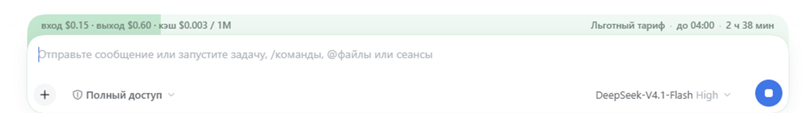

# dsh-peak-opencode · OpenCode Go cost/peak

[](https://github.com/lavandiI/dsh-peak-opencode/actions/workflows/ci.yml)
[](https://www.npmjs.com/package/dsh-peak-opencode)
[](https://github.com/lavandiI/dsh-peak-opencode/blob/main/LICENSE)

**English** · [Русский](https://github.com/lavandiI/dsh-peak-opencode/blob/main/README-ru.md)



The band above the composer in DeepSeek Harness shows the current model's tariff and its price:

- **Peak** — light pink, with a countdown to the end of the period.
- **Off-peak** — light green, also with a countdown.
- **Flat** — soft blue, no countdown: the model has no peak or off-peak hours.
- **Free** — green, no countdown: the price is zero, with no periods or timer.

On the left of the band is the current tariff's price per 1M tokens (`input · output · cache`, plus `write` when the model bills cache writes); on the right are the phase, the period end in your time zone and the time left. The band's fill shows how much of the period remains; flat and free tariffs are filled solid.

Works for **all OpenCode Go models**. The model catalog, prices and multiplier rules are fetched from `opencode.ai` on DSH startup and cached; models with peak hours (DeepSeek V4.1 Flash and V4 Pro) are calculated from the catalog windows, models with a date multiplier (Gemini 4 Argon) by date, free models get the green “Free tariff” band, and the rest get the blue “Flat tariff”.

For a DeepSeek account (`deepseek-account/deepseek-flash` is V4.1 Flash 1017, as well as `deepseek-v4-pro`) prices and peak windows also work: they match DeepSeek's official price list and do not depend on the Go catalog.

## Catalog and rules

Source: the public `https://opencode.ai/inference/go/v1/models` (no API key required).

- On DSH startup the plugin's host half fetches the catalog, caches it for 6 hours and serves it to the browser at `/dsh-peak-opencode/models`. The response is versioned; if an old host is running (after a plugin update without restarting DSH), the client rejects its response and takes the public catalog directly.
- If the host route is not loaded yet (an old host before the DSH restart), the browser fetches the same endpoint directly — CORS is open.
- A catalog snapshot is kept in `localStorage`, so a page refresh paints the band immediately without waiting for the network.
- The settings show how many models the catalog has, which ones have peak hours, which have a date-bound multiplier, when the catalog was updated, and a “Refresh catalog” button.

DeepSeek peak hours from the catalog: **Mon–Fri `01:00–04:00` and `06:00–10:00` UTC** (`09:00–12:00` and `14:00–18:00` Beijing time, `04:00–07:00` and `09:00–13:00` Minsk time), multiplier **×2**. Everything else is off-peak. China's 2026 holidays are built in; moved working Saturdays and Sundays are ignored — DeepSeek looks only at weekdays, weekends and holidays.

Models without multipliers (GLM, Kimi, Qwen, MiniMax, GPT, Claude, Grok and the rest of Go) are shown with the blue “Flat tariff” band: their price is constant. **Free** models (`beam-free`, `iceman-contributor-free`, `longcat-2.5-free`, and renamed ones such as `longcat-2.5-preview-free`) get the green “Free tariff” band: zero price, no peak or off-peak periods. Models **with a ×2 multiplier** are counted as off-peak while the multiplier is inactive: for DeepSeek it turns on by clock (windows above), for Gemini 4 Argon by date `2026-12-01`; before it the band is green, after it pink with the ×2 price.

## Appearance

- The band is as wide as the composer card and shares its top corners. Its bottom edge tucks under the card, so the band's color shows through the card's cutouts.
- **On the left is the current tariff's price** per 1M tokens in the order “input · output · cache”: `input $0.30 · output $1.20 · cache $0.006 / 1M` at peak, `input $0.15 · output $0.60 · cache $0.003 / 1M` off-peak, and the base price for the flat tariff. Cache writes, when the model bills them, appear as `write $…` after cache. Free models get the green band with the label `free`: it does not depend on the model's id in the Go catalog. When the provider renames a free model (`longcat-2.5-preview-free` in DSH vs `longcat-2.5-free` in the catalog), the price is still known from the `-free` suffix; and a free model never inherits a paid catalog entry even if the id matches after stripping the suffix (`step-5-preview-free` and `step-5-preview`).
- For peak models the fill boundary is the percentage of the **remaining** period; on the right are the phase, the period end in your time zone and the time left: `Off-peak tariff · until 13:00 · 3 hr 49 min`.
- A flat-tariff model has a solid blue fill and `Flat tariff · no peak hours` on the right. There is no progress or timer because there is no period.
- A free model has a solid green fill, `Free tariff · no peak hours` on the right and `free` on the left. There is no timer either: the price does not depend on time.
- A date-multiplier model also has a solid fill, colored by phase: before the date `Off-peak tariff · until Dec 1 · 21 days`, after it `Peak tariff · from Dec 1` with the multiplied price.
- On the first screen the price moves to the band's second row — under the “project / mode” chips and above the composer card, since it does not fit on one row with the chips. The band grows by a price line and the card shifts down, keeping the price inside the colored field.
- On the first screen the “project / mode” row overlays the band; the row height, paddings and price line are measured only on real layout changes, so typing does not jiggle the band.
- On narrow windows (below 640px) the price is hidden so it does not cover the labels; on the first screen the band then stays a single row.
- The composer card outline follows the band color: green (off-peak or free tariff), pink or blue.
- The hover tooltip shows the model name, prices per 1M tokens and the peak multiplier (for DeepSeek).

## Settings

**Plugins → OpenCode Go cost/peak** (open the plugin card — settings are shown right on its page, the `plugins.bundle.config` slot):

- **Model catalog** — how many models, which have peak hours, the update time, a “Refresh catalog” button and a warning when the network is unavailable.
- **Peak windows** — Beijing windows converted to your zone; used for peak models. “Restore official windows” fills in the catalog windows.
- **Behavior** — “Show for models outside the Go catalog”: all Go models are already visible; the checkbox adds the blue band to models from other providers.
- **Custom CSS** — added after the base styles. “Apply” is enabled only when changed; after saving or clearing a confirmation appears under the buttons. The field is empty until custom CSS is saved — an example is shown in the guide below.
- **Reset** — a separate block: restores peak windows, behavior and CSS to their defaults and asks for confirmation first.

The plugin has no themes: colors are fixed (green, pink, blue; free models use the same green). If you need other shades, override `--pc-c-valley`, `--pc-c-peak`, `--pc-c-flat`, `--pc-c-free` through “Custom CSS”.

### CSS hooks

| Selector / variable | What it does |
| --- | --- |
| `:root{--pc-c-valley / --pc-c-peak / --pc-c-flat / --pc-c-free}` | colors of the off-peak, peak, flat and free tariff; they also set the card outline |
| `.pc-bar{--pc-band / --pc-tuck / --pc-lift}` | visible height, depth under the card, text lift |
| `.pc-bar[data-hero]{--pc-hero-radius}` | top corners on the first screen |
| `.pc-bar[data-phase="peak"]`, `[data-phase="valley"]`, `[data-phase="flat"]`, `[data-phase="free"]` | styles for a single phase |
| `--pc-pct` | remaining period percentage (`100%` for flat and free tariffs) |
| `.pc-bar[data-hero-price]` | second price row on the first screen: `--pc-hero-price-line` (its height), `top` and the left inset |
| `.pc-price` | the tariff price on the left; on the first screen the band's second row under the chips, hidden on narrow windows |
| `.pc-phase`, `.pc-until`, `.pc-left` | phase, period end and time-left labels |

```css
:root{ --pc-c-valley:#c8ecd8; --pc-c-peak:#ffb3ab; --pc-c-flat:#c7dcf5; --pc-c-free:#c8ecd8 }
.pc-bar[data-hero]{ --pc-hero-radius:20px }
.pc-left{ font-weight:600 }
```

## Languages

The plugin is translated into every language DSH officially supports: **English, Chinese, Japanese, Spanish, French, German, Russian and Portuguese**.

- The plugin **always follows the DSH language**: it has no switch of its own. Change the language in DSH and the band, the plugin panel and the description in Plugins switch immediately.
- The long description on the plugin page is localized too: each `locale/<language>.json` points `meta.detail` at its own `detail/<language>.md`. Without it DSH would show the same `README.md` in every language.
- Dates, weekdays, durations and numbers are formatted with `Intl` for the DSH language (`5 ч 30 мин`, `5 hr 30 min`, `5時間30分`) instead of hand-built strings.
- If the `locale` service is unavailable, the plugin uses `<html lang>` or the browser language; an unknown language falls back to English.
- The plugin manager metadata (`title`, `description`) is provided in `locale/` for all eight languages.

## Installation

### From npm (for everyone)

Published: [`dsh-peak-opencode@0.4.4`](https://www.npmjs.com/package/dsh-peak-opencode) — the current version in the repository.

- GUI: **Settings → Plugins → Install** → `dsh-peak-opencode`
- CLI: `dsh plugin --profile desktop add dsh-peak-opencode`

DSH adds the package to the profile (`dsh.profile.bundles`), applies `cordis.patch.yml` and serves the client half at `/plugins/dsh-peak-opencode/client.js`. After installation, restart DSH (the host half is needed) and refresh the Web GUI page.

### Locally (development)

The plugin can be installed as a local bundle:

```text
plugin_manager action=install_bundle target=<path-to-plugin>
```

or from the GUI: **Settings → Plugins → Install** and the plugin folder path. After installation, refresh the Web GUI page (Ctrl+R / F5).

The client half is picked up by a page refresh. The host half (the catalog route) loads on DSH startup: after changing it, restart the app. Before the restart the plugin falls back to fetching the public catalog directly, so the band does not disappear.

See [PUBLISHING.md](https://github.com/lavandiI/dsh-peak-opencode/blob/main/PUBLISHING.md) for publishing the package for everyone.

## Limitations

- China holidays are available for 2026 only; in other years only weekends are considered.
- The left side shows the **base** price per 1M tokens. For models with a context threshold (GPT Luna, Claude Haiku, Grok 4.7, MiniMax M3, Qwen3.7 Plus) the above-threshold price is not shown — check the OpenCode Go catalog for exact cost.
- **Gemini 4 Argon** has its `×2` multiplier bound to a date (`from 2026-12-01`), not to hours: the model has no hourly windows, so before that date it is off-peak and after it peak. There is no progress within the period; the fill is solid.
- Only the current tariff's price is shown on the left; the ×2 multiplier (peak or date) is applied to it automatically. There is no separate “more expensive” line in the band — it is in the hover tooltip.
- Free models' price does not depend on the catalog: it comes from the `-free` suffix in the id. So `free` is shown even when Go renamed the model and the catalog found no exact match.
- The catalog and peak multipliers are public OpenCode Go data; if the provider changes the format, the plugin falls back to the built-in DeepSeek rules and shows a warning in the settings.
- For other providers (not `opencode-go`) the Go catalog does not apply: DeepSeek is calculated by the built-in rules, and other models get the blue band only with “Show for models outside the Go catalog” enabled.
- Positioning relies on the `conversation.input.dock` slot and the `data-composer-card` attribute; if the host changes the contract, the band simply stops appearing. Settings register in the `plugins.bundle.config` slot by package name and appear on the plugin page in Plugins; if the slot is renamed, the settings panel disappears while the band keeps working.

## Internals

- `lib/index.js` — the host half: fetches the catalog on DSH startup, caches it and serves `/dsh-peak-opencode/models`.
- `lib/client.js` — the band, settings, catalog parsing, dictionaries for eight languages and the direct fallback request; registered through `window.__ModuleLoader__.load`.
- Settings live in `localStorage` (`dsh-peak-opencode:settings`); the catalog snapshot is in `dsh-peak-opencode:catalog:v3`.
- `locale/<language>.json` — title, short description and `meta.detail`; `detail/<language>.md` — the long description DSH shows on the plugin page.
- Slots: `conversation.input.dock` (`order: 60`) for the band and `plugins.bundle.config` (`key: dsh-peak-opencode`) for the settings panel on the plugin page.
- No build step: plain ESM/JS. `npm test` checks syntax, renders the band and settings against a React stub (blue and green bands, all languages, “same as DSH” mode) and the host catalog route on the real endpoint format.

## Contributing

Issues and pull requests are welcome. See [CONTRIBUTING.md](https://github.com/lavandiI/dsh-peak-opencode/blob/main/CONTRIBUTING.md) for the development workflow and [CODE_OF_CONDUCT.md](https://github.com/lavandiI/dsh-peak-opencode/blob/main/CODE_OF_CONDUCT.md) for community expectations.

## Security

Please report vulnerabilities privately through the repository's Security tab; see [SECURITY.md](https://github.com/lavandiI/dsh-peak-opencode/blob/main/SECURITY.md).

## License

[MIT](https://github.com/lavandiI/dsh-peak-opencode/blob/main/LICENSE) © lavandil
